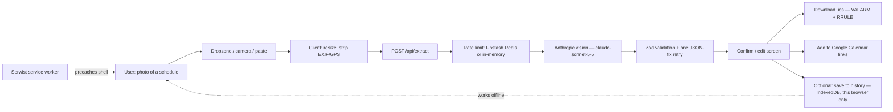

# RoutineSnap

**Snap your routine. Never miss a thing.**

RoutineSnap turns a photo or screenshot of any schedule — class routine,
exam routine, duty roster, wedding invitation card, medicine prescription,
cricket fixture — into calendar events with reminders, in seconds. Free,
privacy-first, works in the browser, installable as an app (PWA).

> **Status: all 9 steps complete.** Scaffold, landing page, `/scan` with
> mock + real extraction, ICS export, `/api/extract` with Anthropic vision,
> templates / history / blog / legal, PWA + offline, SEO + security headers
> + analytics, and final docs + QA. `pnpm build`, `pnpm lint` and
> `pnpm test` (67 tests) all pass. See [QA](#qa-step-9) for the final
> checklist.

## Features

- **Photo → calendar:** upload, drag-drop, camera, or paste a schedule
  photo; vision AI returns structured events; you confirm and edit every
  event before anything is exported.
- **Six categories:** class routine, exam routine, duty roster, invitation
  card, medicine schedule, match fixture — plus auto-detect.
- **Exports that work everywhere:** download a standard `.ics` file (with
  `VALARM` reminders and recurrence) or per-event "Add to Google Calendar"
  links — no sign-in, no OAuth.
- **Reminders, plural:** each event can have several reminders (e.g. 1 day
  and 2 hours before an exam). The editor supports adding/removing them;
  the `.ics` file gets one `VALARM` per reminder.
- **Three languages:** English, Bangla, and Japanese — landing page, scan
  flow, templates, and legal pages, plus Bangla/Japanese text recognition
  in photos.
- **Privacy-first:** photos are processed in memory and discarded; nothing
  is stored on the server, there is no database, no cookies, no trackers
  unless you opt into Plausible (see below). Saved history lives only in
  your browser (IndexedDB).
- **Installable PWA:** works offline for the shell and history, with an
  install prompt and a friendly offline page.
- **Light and dark themes**, system default, mobile-first, WCAG AA.

## Getting started

Requires Node.js 20+ and pnpm 10+.

```bash
cp .env.example .env.local   # fill in keys when you have them
pnpm install
pnpm dev                      # http://localhost:3000 → redirects to /en
pnpm build
pnpm lint
pnpm test                     # Vitest: 67 tests
pnpm start                    # serve the production build
```

The app runs fully with the **mock extractor** when no Anthropic key is
set, so you can try the whole scan → edit → export flow without any keys.

## Environment variables

Copy `.env.example` to `.env.local`. Nothing is required — every variable
has a safe default.

| Variable | Default | What it does |
| --- | --- | --- |
| `ANTHROPIC_API_KEY` | *(empty)* | Anthropic key for real vision extraction. Empty → the mock extractor is used, so scanning still works end-to-end. Get a key at https://console.anthropic.com → API Keys. |
| `ANTHROPIC_MODEL` | `claude-sonnet-5-5` | Claude vision-capable model used by `/api/extract`. |
| `UPSTASH_REDIS_REST_URL` | *(empty)* | Upstash Redis URL for rate limiting. Empty → in-memory per-IP counter (fine for dev / single server). |
| `UPSTASH_REDIS_REST_TOKEN` | *(empty)* | Upstash Redis token (pair with the URL above). |
| `NEXT_PUBLIC_SITE_URL` | `http://localhost:3000` | Public base URL. Used for canonical URLs, sitemap, and OpenGraph. **Set this to your real domain before deploying**, or those will point at localhost. |
| `NEXT_PUBLIC_PLAUSIBLE_DOMAIN` | *(empty)* | Plausible-compatible analytics domain. Empty → no analytics script is loaded at all (no request, no cookies). |
| `DAILY_SCAN_LIMIT` | `5` | Free-tier scans per day per IP. |

## Scripts

| Script | What it does |
| --- | --- |
| `pnpm dev` | Dev server with Turbopack (service worker disabled in dev). |
| `pnpm build` | Production build (webpack — see the Serwist note below). |
| `pnpm start` | Serve the production build. |
| `pnpm lint` | ESLint. |
| `pnpm test` | Vitest, `tests/` — ICS, Google Calendar links, mock → ICS flow, extraction schema/prompts/rate limiting, blog, SEO, reminders. |
| `pnpm icons` | Regenerate PWA icons from `public/icons/icon.svg` (`scripts/generate-icons.mjs`, uses `sharp`). |
| `pnpm og` | Regenerate the OpenGraph image from `public/og/og.svg` (`scripts/generate-og.mjs`, uses `sharp`). |

## How it works



1. **Upload** — JPG/PNG/WEBP/HEIC (HEIC converted client-side), max 8 MB,
   resized to max 2000px on the long edge, EXIF/GPS stripped by
   re-encoding (`src/lib/image.ts`).
2. **Extract** — `POST /api/extract` (multipart: `image`, `category`,
   `locale`, `timezone`, `referenceDate`). Honeypot check → IP rate limit
   → image validation → vision extraction → Zod validation. The image is
   processed in memory and discarded; nothing is stored or logged.
3. **Confirm** — the mandatory review screen: editable table/cards with
   the original photo beside them (desktop) or Photo/Events tabs (mobile),
   low-confidence fields in amber with "Please check", bulk actions
   (select/delete, shift all times, set reminder for all), warnings and
   assumptions shown. Medicine schedules need the "I verified these
   doses" checkbox before export.
4. **Export** — `.ics` download, Google Calendar links, copy as text,
   WhatsApp share, and an optional save to local history.

## Architecture

- **Stack:** Next.js 15.5 (App Router) + React 19 + TypeScript strict,
  Tailwind CSS v4 + shadcn/ui (Radix) + lucide-react, Framer Motion,
  next-themes (default system), next-intl (`en` default, `bn`, `ja`),
  Zod, react-hook-form, date-fns + date-fns-tz, idb-keyval, Anthropic SDK.
- **Product name:** change it once in `src/config/site.ts`.
- **Categories:** `src/config/categories.ts` holds all six (slug, emoji,
  en/bn/ja name + description, hints, recurrence, rules); the landing
  use-case chips and template pages read from it.
- **AI layer:** `src/lib/ai/extractor.ts` (`ScheduleExtractor` interface;
  `AnthropicExtractor` with the SDK imported dynamically so the browser
  bundle never includes it; `MockExtractor` with realistic per-category
  samples). Per-category prompts in `src/lib/ai/prompts/` with the shared
  base rules in `prompts/index.ts`: extract only what is visible, never
  invent data, convert Bangla/Japanese digits, normalise 12h → 24h, low
  confidence + warning when unsure.
- **ICS export (`src/lib/ics.ts`):** hand-written RFC 5545 generator —
  chosen over the `ics` npm package because the package has no VTIMEZONE
  support, no per-event TZID control, and cannot express RRULE
  UNTIL-in-UTC + VALARM combinations cleanly. Emits `DTSTART;TZID=` with
  a VTIMEZONE block for fixed-offset zones (Asia/Dhaka +06:00, Asia/Tokyo
  +09:00, Asia/Kolkata +05:30); zones with daylight saving fall back to
  UTC (`DTSTART:…Z`). Handles weekly/DAILY recurrence (UNTIL is
  end-of-day in the event timezone, COUNT wins over UNTIL), all-day
  events (DATE values), midnight-crossing shifts, one VALARM per
  reminder, text escaping (Bangla/Japanese kept as UTF-8) and 75-octet
  line folding that never splits a multi-byte character.
- **Google Calendar links (`src/lib/calendar-links.ts`):** TEMPLATE
  links, no OAuth. All-day events use Google's date-only format,
  DAILY recurrences carry UNTIL/COUNT, and WEEKLY UNTIL is end-of-day
  UTC (23:59:59Z) so the last day is not excluded in +05:30/+06:00/+09:00
  zones.
- **Rate limiting (`src/lib/rate-limit.ts`):** Upstash Redis sliding
  window (24h) when configured, otherwise an in-memory per-IP daily
  counter. Limited requests get `429` with `Retry-After` and
  `X-RateLimit-*` headers; a limiter failure falls back to memory and
  never takes the API down.
- **History (`src/lib/history.ts`):** IndexedDB via idb-keyval, browser
  only, never on the server. Saving happens on export when "Save to
  local history" is ticked; a failed write (e.g. private mode) never
  blocks export.
- **Motion:** Framer Motion fade-up on scroll (stagger 80ms), hover lift
  on cards, floating hero mockup — all static under
  `prefers-reduced-motion`.

## Project structure

```
src/
  app/
    layout.tsx            # root layout (passes through; [locale] renders <html>)
    globals.css           # Tailwind v4 + RoutineSnap design tokens
    manifest.ts           # /manifest.webmanifest (Step 7)
    robots.ts / sitemap.ts# /robots.txt, /sitemap.xml (Step 8)
    sw.ts                 # Serwist service worker source -> public/sw.js
    api/
      extract/route.ts    # POST /api/extract (Step 5)
      health/route.ts     # GET /api/health
    [locale]/
      layout.tsx          # fonts, providers, header, footer, analytics
      page.tsx            # landing page
      scan/page.tsx       # /scan
      history/page.tsx    # /history (IndexedDB)
      templates/          # /templates, /templates/[slug]
      blog/               # /blog, /blog/[slug] (MDX)
      privacy/ terms/ about/ offline/
      loading.tsx error.tsx not-found.tsx
  components/
    common/               # header, footer, theme/language, install prompt,
                          # analytics, JSON-LD, offline actions
    landing/              # hero, features, how-it-works, FAQ, ...
    scan/                 # dropzone, category picker, image viewer,
                          # event card, events editor, export bar
    history/ templates/ providers/ ui/   # shadcn/ui (button, accordion)
  config/ site.ts categories.ts
  i18n/ routing.ts request.ts navigation.ts
  lib/
    ai/                   # schema, extractor, prompts/ (one per category)
    ics.ts calendar-links.ts dates.ts image.ts
    history.ts rate-limit.ts reminders.ts seo.ts
    blog.ts utils.ts
content/blog/             # 3 starter MDX posts
messages/                 # en.json, bn.json, ja.json (key parity enforced)
public/icons/ og/         # PWA icons, OpenGraph image (generated, see scripts)
scripts/                  # generate-icons.mjs, generate-og.mjs
docs/ANDROID.md           # Capacitor guide (docs only, no native code)
```

## Privacy

- Photos and extracted data are **not stored on the server**: processed
  in memory, returned, discarded. No database, no logging of image data
  or extracted content.
- Saved history is local only (IndexedDB in your browser). Nothing
  leaves the device except the photo you choose to scan, sent to the
  extraction API for that one scan.
- No cookies, no third-party fonts (self-hosted via Fontsource), no
  trackers unless `NEXT_PUBLIC_PLAUSIBLE_DOMAIN` is set — and Plausible
  itself sets no cookies. See `/privacy` in the app for the plain-language
  version.

## Deployment

### Vercel (recommended for the web app)

1. Push the repo to GitHub and import it in Vercel, or run `vercel`
   from the project folder.
2. Set the environment variables in the Vercel dashboard — at minimum
   `NEXT_PUBLIC_SITE_URL` to your real domain (canonicals, sitemap, and
   OpenGraph URLs use it), plus `ANTHROPIC_API_KEY` for real extraction
   and `UPSTASH_REDIS_REST_URL` / `UPSTASH_REDIS_REST_TOKEN` if you want
   shared rate limiting across Vercel's edge instances.
3. Deploy. No build settings to change: `pnpm build` / `pnpm start`
   are the defaults.

### Your own server

```bash
git clone <your-repo>
cd routinesnap
cp .env.example .env.local   # set NEXT_PUBLIC_SITE_URL, ANTHROPIC_API_KEY, ...
pnpm install
pnpm build
pnpm start                   # listens on http://localhost:3000 by default
```

Run it behind a reverse proxy (nginx/Caddy) with HTTPS — the PWA
service worker and camera access require a secure context. For
always-on operation use a process manager, e.g.:

```bash
pnpm add -g pm2
pm2 start pnpm --name routinesnap -- start
pm2 save && pm2 startup
```

Or with Docker — a `Dockerfile` is shipped in the repo root:

```bash
docker build -t routinesnap .
docker run -p 3000:3000 --env-file .env.local routinesnap
```

It is a three-stage build (deps → builder → runner) on `node:20-alpine`,
so the final image carries only the production server, `.next`, and
`public`. Set `NEXT_PUBLIC_SITE_URL` to your real domain in
`.env.local` before building. Note: the image was not build-tested in
this environment (no Docker here) — run the build on your server or PC
first and report any error.

Note the in-memory rate-limit fallback counts per server process — with
more than one server instance, set up Upstash Redis so the limit is
shared.

## PWA, install prompt, offline

- **Service worker:** `@serwist/next` 9.5 + `serwist` 9.5, built from
  `src/app/sw.ts` to `public/sw.js` (generated, gitignored). Serwist was
  chosen over `next-pwa` as the maintained successor (same Workbox
  lineage, actively developed for Next 15). It precaches the app shell —
  home, scan, history, and the offline page per locale, plus public
  files and build assets — uses Serwist's Next.js `defaultCache` preset
  (NetworkFirst pages/RSC, CacheFirst/StaleWhileRevalidate assets, never
  caches `POST /api/extract`), and serves the matching locale's
  `/offline` page when a navigation fails offline. History works offline
  because it is IndexedDB-only and the shell is precached.
- **Manifest:** `src/app/manifest.ts` serves `/manifest.webmanifest`
  (name/short_name RoutineSnap, `start_url: /scan`, `display:
  standalone`, theme `#6366F1`). Icons are generated from
  `public/icons/icon.svg` / `icon-maskable.svg` — run `pnpm icons` to
  regenerate the 192/512/maskable-512/180px PNGs.
- **Install prompt:** `src/components/common/install-prompt.tsx`
  (rendered in the locale layout). Android/desktop Chrome: listens for
  `beforeinstallprompt` and shows a custom banner with Install. iOS
  Safari: shows "Share → Add to Home Screen" steps instead.
  Dismissing remembers for 14 days (localStorage); a successful install
  hides it for good; nothing shows when already running standalone.
  Strings are in `messages/{en,bn,ja}.json` (`pwa` namespace), motion
  respects `prefers-reduced-motion`.
- **Offline page:** `/[locale]/offline` — explains scanning needs the
  internet while saved history still works, with Try again + View
  history buttons.
- **Test install + offline:** `pnpm build && pnpm start`, open
  `http://localhost:3000`, check `/manifest.webmanifest` returns 200
  and `/sw.js` registers (DevTools → Application → Service Workers),
  then DevTools → Network → Offline and reload — the offline page
  should show, and `/en/history` should still render saved scans.

## SEO, security headers, analytics

- **Metadata:** every page has `generateMetadata` via the shared helper
  `src/lib/seo.ts` (`pageMetadata`): translated title/description from
  `messages/{en,bn,ja}.json`, canonical URL, OpenGraph + Twitter cards
  with the 1200×630 image, and `hreflang` alternates for en/bn/ja +
  `x-default`. The layout adds `metadataBase` and a `%s | RoutineSnap`
  title template.
- **Sitemap + robots:** `src/app/sitemap.ts` lists all routes in all
  three locales (54 entries); `src/app/robots.ts` allows all crawlers
  and points at `/sitemap.xml`.
- **OpenGraph image:** `public/og/og.png` (1200×630, brand gradient +
  calendar mark + name + tagline), generated from `public/og/og.svg` —
  run `pnpm og` after editing the SVG.
- **JSON-LD:** `src/components/common/json-ld.tsx` + builders in
  `src/lib/seo.ts`. Landing page carries `SoftwareApplication`,
  `WebSite`, and `FAQPage` (built from the real translated FAQ items);
  template and blog-post pages carry a `BreadcrumbList`. The data is
  built from the same strings the page shows, so it cannot drift.
  Covered by `tests/seo.test.ts`.
- **Security headers:** set in `next.config.ts` for every route — CSP,
  `X-Content-Type-Options: nosniff`, `Referrer-Policy`,
  `Permissions-Policy` (camera only on self; microphone/geolocation
  off), `X-Frame-Options: DENY`, HSTS,
  `Cross-Origin-Opener-Policy`. CSP trade-off: `script-src` /
  `style-src` keep `'unsafe-inline'` because Next.js inline scripts
  require it without a nonce setup; everything else is locked down.
  Plausible's host is added to `script-src`/`connect-src` only when
  `NEXT_PUBLIC_PLAUSIBLE_DOMAIN` is set.
- **Analytics:** `src/components/common/analytics.tsx` (rendered in the
  locale layout). Plausible-compatible script, optional via
  `NEXT_PUBLIC_PLAUSIBLE_DOMAIN` only — when unset it renders nothing:
  no script, no request, no cookies. No other tracker is loaded.

## Templates, history, blog, legal

- **Templates:** `/templates` hub + `/templates/[slug]` per category
  (name/description/tips from `src/config/categories.ts`, CSS-built
  example photo, CTA to `/scan?category=slug`). Unknown slug → 404.
- **History:** `/history` reads saved scans from IndexedDB — list, view
  events, re-download `.ics`, delete one, delete all. Empty state when
  nothing is saved.
- **Blog:** MDX with `next-mdx-remote/rsc` (chosen over `@next/mdx`
  because it needs no webpack config and works with the Turbopack
  build). Posts in `content/blog/*.mdx` with title/date/excerpt
  frontmatter, parsed by `src/lib/blog.ts`. List + post pages are
  translated; post bodies are written in English for now and the pages
  say so — no fake translations.
- **Legal + About:** `/privacy`, `/terms` (plain language, copy in
  `messages/{en,bn,ja}.json`), `/about` (contact links are config-driven
  only; no email is invented — the page says so when none is set).
  Branded `loading.tsx`, `error.tsx`, `not-found.tsx` under `[locale]`.

## Android app

`docs/ANDROID.md` explains wrapping the site with Capacitor (hosted
approach recommended — the app loads the deployed site so
`/api/extract` keeps working — camera + local-notifications, building
an AAB, Play Store checklist). `capacitor.config.ts` at the repo root is
a placeholder only; **no native code is implemented**.

## Build history

1. ✅ **Scaffold** — Next.js 15 + Tailwind v4 + shadcn/ui, next-intl
   (en/bn/ja), next-themes, design tokens, `.env.example`.
2. ✅ **Landing page** — Navbar, Hero with photo-to-calendar mockup,
   use-case chips, features, How It Works with looping phone
   notification preview, Why It Matters SEO text, stats, 10-question
   FAQ, maker note, final CTA, footer.
3. ✅ **`/scan` UI with mock extractor** — upload (drag-drop, camera,
   paste), category picker, confirm/edit screen, export bar (Google
   links, copy, WhatsApp). `.ics` and history were disabled placeholders.
4. ✅ **ICS export + Google Calendar links** — hand-written RFC 5545
   generator, 21 tests.
5. ✅ **`/api/extract` with real vision model** — Anthropic vision,
   per-category prompts, Zod validation, rate limiting, mock fallback.
6. ✅ **Templates, history, blog, legal pages** — IndexedDB history,
   MDX blog (3 posts), branded loading/error/404.
7. ✅ **PWA, install prompt, offline page** — Serwist service worker,
   manifest + icons, iOS instructions, `docs/ANDROID.md`.
8. ✅ **SEO, security headers, analytics** — metadata, sitemap/robots,
   OG image, JSON-LD, headers, Plausible hook, 10 new tests.
9. ✅ **Docs, final polish, QA** — this README, multi-reminder editor
   fix (see below), full QA checklist.

### Known deviations from the original spec (deliberate)

- **Fonts are self-hosted via Fontsource**, not `next/font/google` —
  Google's css2 API no longer labels Noto Sans JP's slices with a
  `japanese` subset, so the build rejects it, and self-hosting keeps
  builds offline and sends no font request to a third party
  (privacy-first). Same families and weights as specced.
- **`pnpm build` runs plain `next build` (webpack), not `--turbopack`.**
  `@serwist/next` is webpack-based: under Turbopack the build succeeds
  but silently produces no `sw.js`. Dev stays on Turbopack; the worker
  is disabled in dev. If Serwist ships stable Turbopack support, the
  flag can go back.
- **CSP keeps `'unsafe-inline'`** for `script-src`/`style-src` (see the
  SEO section above) — Next.js inline scripts require it without a
  nonce setup.
- **How It Works is a 2×2 grid** beside the phone on desktop, not 4
  columns — 4 columns would be unusably narrow.
- **Footer socials** use simple glyph tiles and `siteConfig.socials`
  are all empty, so no social links render yet (no dead links). The
  maker note has no founder name in the spec, so it reads "The maker of
  RoutineSnap" with an "RS" avatar placeholder. Stats are placeholder
  examples, marked as such in code comments.
- **Blog post bodies are English-only** for now (the pages say so).
  The category `specialRules` line on template pages is English-only
  (it is prompt-facing English in `categories.ts`); the localised
  `rules` tips are the main content.
- **Muted text** is darkened slightly from the `#8A8AA0` token on light
  mode for WCAG AA contrast; the token itself is unchanged.

### Fixed in Step 9 — multi-reminder editor

The Step 4 limitation is fixed: the event editor used to expose only
the first reminder per event (single dropdown), so editing an exam
event collapsed `[1440, 120]` to `[1440]` and the 2-hour alarm was lost
on export. The editor (`src/components/scan/event-card.tsx`) now shows
one row per reminder with add/remove buttons, backed by pure helpers in
`src/lib/reminders.ts` (`normalizeReminders`, `remindersFromStrings`,
`nextReminderPreset`) and covered by `tests/reminders.test.ts` (7
tests, including the `[1440, 120]` round-trip regression test). New
translated labels (`fieldReminders`, `addReminder`, `removeReminder`,
`reminder120`, `reminderCustom`) were added to all three locales with
key parity verified (257 keys per locale).

## QA (Step 9)

Run on 2026-11-16 against the production build (`pnpm build && pnpm
start`), plus `pnpm dev`, `pnpm lint`, `pnpm test`:

| Check | Result |
| --- | --- |
| `pnpm build` / `pnpm lint` / `pnpm test` | ✅ Pass — **67 tests, 7 files** |
| `pnpm dev` (Turbopack) | ✅ Zero errors; `/en` and `/bn/scan` return 200 |
| Every route in en/bn/ja: `/`, `/scan`, `/history`, `/templates` + 6 slugs, `/blog` + 3 posts, `/privacy`, `/terms`, `/about`, `/offline` | ✅ All 200 |
| `/sitemap.xml`, `/robots.txt`, `/manifest.webmanifest`, `/sw.js`, `/og/og.png`, `/api/health` | ✅ All 200; sitemap has 54 `<url>` entries |
| Unknown template/blog slugs | ✅ Branded 404 |
| Security headers on `/en` | ✅ CSP, nosniff, referrer, permissions (camera=self only), XFO DENY, HSTS |
| JSON-LD on `/en` | ✅ Parses: `SoftwareApplication`, `WebSite`, `FAQPage`; Bangla FAQ parses on `/bn` |
| Mock scan flow (no key): `POST /api/extract` exam routine | ✅ 200, 3 events, first event keeps `[1440, 120]`; mock → ICS flow covered by tests (6 VALARMs for 3 exams) |
| No English leaks on bn/ja landing + scan (visible text + `<title>`) | ✅ Fully translated. Note: the raw HTML contains English inside the RSC flight payload (serialised alternate-locale link data) and in `og:image:alt` for the shared English OG image — neither is visible text. |
| Light / dark themes | ✅ Tokens verified in `globals.css` (light bg `#FAFAFC`, dark `#0A0A0F`, class-based `.dark` variant, muted text darkened for WCAG AA on light). No browser was available in this environment for a visual pixel check. |
| `.env.example` vs README | ✅ Complete, all 7 variables documented above |
| `.gitignore` | ✅ Excludes `node_modules`, `.next`, `.env*`, `public/sw.js`, `.vercel` |
| Secrets in repo (`sk-ant-`, key values) | ✅ None found |
| Dead links (Navbar/Footer) | ✅ All internal hrefs resolve; social links render only when configured |
| Lighthouse (landing: Performance 90+, Accessibility 95+, SEO 95+) | ⚠️ **Not run** — no Lighthouse or Chromium/Chrome binary exists in this environment, and no browser was installed just for this. Run it yourself after deploy: `npx lighthouse http://localhost:3000/en --view`. PWA installability was verified headlessly instead (manifest + service worker serve, shell precached). |
| Real-key extraction | ⚠️ **Not run** — no Anthropic key in this environment. The mock path is fully tested; test with a key with `ANTHROPIC_API_KEY` in `.env.local` and check `/api/health` reports `"extractor": "anthropic"`. |

## Roadmap

- [ ] Run Lighthouse after deploy and fix any Performance/Accessibility
      findings (see QA table above).
- [ ] Translate the three blog posts into Bangla and Japanese.
- [ ] Add founder name + real social links in `src/config/site.ts`.
- [ ] Android app via Capacitor — follow `docs/ANDROID.md`.
- [ ] Optional: account-free push reminders (Web Push) for events saved
      in history; native reminders in the Capacitor app.
- [ ] Optional: more categories (timetable for teachers, prayer times,
      bus/train schedules) — add a prompt file + a category entry.
